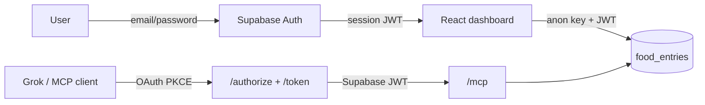

# Input Output

A single-page daily-nutrition dashboard with per-user accounts, backed by Supabase Auth + RLS, and a companion MCP server for AI agents.

## Stack

- **React 19** + **Vite 8** + **Tailwind 4** — web dashboard (`packages/web`)
- **TypeScript 5.7** with `strict: true` across all packages
- **Supabase Auth** — email/password sign-up and sign-in
- **Supabase Postgres + RLS** — each user sees only their own `food_entries`
- **MCP** — stdio server (local) and Streamable HTTP server (deployed) — `packages/mcp-server`
- **Cloudflare Pages** — production hosting; Pages Function serves `/mcp`

This is an **npm workspaces** monorepo. There is one lockfile at the root and one TypeScript version pinned across all packages.

## Repository layout

```
input_output/
├── package.json              # npm workspaces root
├── tsconfig.base.json        # shared compiler options (strict)
├── .env.example              # Supabase URL + anon key
├── AUDIT.md                  # code-audit report (Phase 6)
├── packages/
│   ├── shared/               # types, validation, transforms (no Supabase dep)
│   │   ├── src/              # source
│   │   ├── dist/             # compiled output
│   │   └── migrations/       # SQL migrations for Supabase
│   ├── web/                  # React app + Pages Functions
│   │   ├── src/              # React source (auth UI + dashboard)
│   │   ├── functions/        # Cloudflare Pages Functions
│   │   │   └── mcp/[[path]].ts
│   │   ├── wrangler.toml
│   │   └── vite.config.ts
│   └── mcp-server/           # MCP server: stdio + HTTP transports
│       ├── src/stdio.ts      # `npm run mcp` (local dev)
│       └── src/http.ts       # Cloudflare Pages Function entry
```

## Prerequisites

- Node.js ≥ 20
- npm ≥ 7 (workspaces)
- A Supabase project with **Email** auth enabled
- For Cloudflare deployment: a Cloudflare account + `wrangler` (installed via the web package)

## Setup

1. Install dependencies from the root:

   ```sh
   npm install
   ```

2. Run migrations in the Supabase SQL editor (in order):

   ```
   packages/shared/migrations/0001_add_entry_date.sql
   packages/shared/migrations/0002_auth_and_user_scoping.sql
   packages/shared/migrations/0003_activities.sql
   ```

3. In the Supabase dashboard → **Authentication** → **Providers**, enable **Email**.

4. Set **Site URL** and redirect URLs (`http://localhost:5173`, your production Pages URL).

5. Create `packages/mcp-server/.env` (see `.env.example`):

   ```ini
   SUPABASE_URL=https://<your-project>.supabase.co
   SUPABASE_ANON_KEY=<anon-key-from-project-settings>
   VITE_SUPABASE_URL=https://<your-project>.supabase.co
   VITE_SUPABASE_ANON_KEY=<same-anon-key>
   ```

   `npm run dev` and `npm run dev:mcp` auto-build the shared + mcp-server packages (see `prebuild`/`pretypecheck` scripts), so no manual build step is needed for normal development.

   The anon key is public by design; **RLS** enforces per-user data isolation.

## Scripts

| Command                           | What it does                                                    |
| --------------------------------- | --------------------------------------------------------------- |
| `npm run dev`                     | Build shared, then start the web app at `http://localhost:5173` |
| `npm run dev:mcp`                 | Build shared, then start the MCP server (stdio)                 |
| `npm run build`                   | Build shared, then build the web app for production             |
| `npm run typecheck`               | TypeScript check across all workspaces (app + functions)        |
| `npm run lint`                    | ESLint on the web package                                       |
| `npm run test`                    | Run the vitest suite in `packages/shared`                       |
| `npm run format` / `format:check` | Apply / verify Prettier formatting                              |
| `npm run build:shared`            | Compile `@input_output/shared` to `dist/`                  |

## Architecture

- `packages/shared` is a pure TypeScript package. It defines the `Database` type, validation helpers, and transforms. **It has no Supabase dependency**.
- `packages/web` is the dashboard. Signed-in users talk **directly to Supabase** via the anon key + session JWT. RLS on `food_entries` scopes every query to `auth.uid()`.
- `packages/mcp-server` exposes one server in two transports:
  - **stdio** (`src/stdio.ts`) — for local AI agents. Requires `SUPABASE_ACCESS_TOKEN` (copy from a signed-in web session).
  - **HTTP** (`src/http.ts`) — stateless Streamable HTTP at `/mcp/*`. Requires `Authorization: Bearer <access_token>` on every request.

## Auth flow



Grok and other OAuth-capable MCP clients use the built-in OAuth 2.1 + PKCE flow (`/authorize`, `/token`, `/.well-known/*`). The issued access token is the user's Supabase session JWT, so RLS still scopes all tool calls per user.

## Cloudflare deployment

### One-time setup

```sh
npx wrangler login
npx wrangler pages project create input-output --production-branch main

npx wrangler pages secret put SUPABASE_URL          --project-name input-output
npx wrangler pages secret put SUPABASE_ANON_KEY     --project-name input-output
npx wrangler pages secret put OAUTH_SIGNING_SECRET  --project-name input-output
```

Set build-time vars before `npm run build` (embedded in the client bundle):

```sh
export VITE_SUPABASE_URL=https://<your-project>.supabase.co
export VITE_SUPABASE_ANON_KEY=<anon-key>
```

### Deploy

```sh
npm run build
npx wrangler pages deploy packages/web/dist --project-name input-output --branch main
```

### Routes exposed

| Path                                                  | Purpose                                                    |
| ----------------------------------------------------- | ---------------------------------------------------------- |
| `/`                                                   | Static React dashboard (sign-in required)                  |
| `/mcp`                                                | MCP HTTP endpoint — requires `Authorization: Bearer <jwt>` |
| `/authorize`, `/token`, `/register`, `/.well-known/*` | OAuth for Grok and other MCP clients                       |

### Local Pages preview

```sh
cd packages/web
npm run pages:dev
```

Serves `dist/` and `functions/` on `http://localhost:8788`.

### Local stdio MCP

1. Sign in via `npm run dev`
2. Copy your session `access_token` (browser devtools → Application → local storage, or `supabase.auth.getSession()` in console)
3. Set `SUPABASE_ACCESS_TOKEN` in `packages/mcp-server/.env`
4. Run `npm run dev:mcp`

Tokens expire (~1 hour); refresh after re-login.

## Fitness tracker sync (Google Health)

Input Output reads workouts, daily calories, steps and weight from the **Google Health API**
(the cloud successor to the Fitbit Web API; the Google Fit REST API shuts down in 2026,
and Health Connect is on-device only). Requires migration
`packages/shared/migrations/0024_integrations_estimates_weight.sql`.

1. In Google Cloud Console, create an OAuth client (Web application) and enable the
   Google Health API. Authorized redirect URI:
   `https://<your-domain>/api/integrations/google-health/callback`.
2. Request the read-only scopes `googlehealth.activity_and_fitness.readonly` and
   `googlehealth.health_metrics_and_measurements.readonly`. They are **Restricted**:
   until Google's privacy and security review passes, only test users added to the
   OAuth consent screen can connect.
3. Add Cloudflare secrets:
   ```sh
   wrangler pages secret put GOOGLE_HEALTH_CLIENT_ID
   wrangler pages secret put GOOGLE_HEALTH_CLIENT_SECRET
   wrangler pages secret put INTEGRATION_ENCRYPTION_KEY   # 32+ random characters
   ```

How it works:

- Me › Profile › Fitness tracker › **Connect Google Health** runs OAuth. Refresh tokens are
  stored AES-GCM encrypted (`fitness_connections`); the key never leaves Cloudflare.
- Sync runs when the dashboard opens (at most hourly), from **Sync now**, and from the MCP
  tool `sync_fitness_tracker`. First sync backfills 14 days; a call covers up to 30.
- A finished day's tracker total replaces BMR as that day's base. Today keeps BMR until the
  day ends (a partial total would understate output). Synced workouts inside a device
  total are flagged `counted_in_device_total`, so their calories aren't added twice.
- Re-syncing updates workouts in place (matched on the Google data point name).

Endpoints: `/api/integrations/google-health/{start,exchange,callback,status,sync,settings,disconnect}`.

## Logging by conversation (MCP)

The MCP server (`/mcp`) gives an LLM everything needed to log food and exercise from a
conversation, including rough estimates:

| Tool | Purpose |
| --- | --- |
| `get_user_context` | Age, sex, height, latest weight, BMR, goals, time zone, whether a weigh-in is due, tracker status, estimation guidance |
| `add_food_entry` | Now records `logMethod` (`weighed` / `unit` / `estimate`), `confidence` and `estimateNotes` |
| `search_food_history` | The user's past entries for a food ("my usual flat white") with typical calories |
| `add_activity` | Omit `calories` and the server estimates them from duration, `intensity` and weight (MET-based, net of resting) |
| `estimate_activity_calories` | The same estimate without logging |
| `log_weight`, `get_weight_history` | Weigh-ins (kg or lb) and the smoothed trend; updates the BMR weight |
| `snooze_weight_checkin`, `update_weight_checkin_settings` | Check-in cadence (weekly by default, 3–30 days) |
| `get_fitness_tracker_status`, `sync_fitness_tracker` | Tracker connection and on-demand sync (hosted server only) |

The server's `instructions` tell the LLM to call `get_user_context` first, mark estimates
honestly, sync the tracker before hand-logging workouts, and ask for weight once when a
check-in is due.

## Data model

```sql
-- auth.users managed by Supabase Auth

create table public.profiles (
  id           uuid primary key references auth.users(id) on delete cascade,
  display_name text not null,
  created_at   timestamptz default now()
);

create table public.food_entries (
  id          text primary key,
  user_id     uuid not null references auth.users(id) on delete cascade,
  icon        text    default 'fa-utensils',
  icon_bg     text    default '#f4f4f5',
  icon_color  text    default '#71717a',
  name        text    not null,
  description text    default '',
  calories    integer not null default 0,
  protein     integer not null default 0,
  carbs       integer not null default 0,
  caffeine    integer not null default 0,
  created_at  timestamptz default now(),
  entry_date  date not null default current_date
);
```

RLS policies ensure users can only read/write their own rows. See `0002_auth_and_user_scoping.sql` for the full migration.

## Security

- **Web app**: Supabase anon key + user session JWT. RLS enforces `auth.uid() = user_id`.
- **MCP**: Same JWT-scoped client — no service-role key in user-facing paths.
- **No shared-secret API proxy** — the old `X-Internal-Token` / `/api/entries` layer has been removed.

See `AUDIT.md` for additional hardening ideas (email confirmation UI, per-user goals, OAuth providers).
